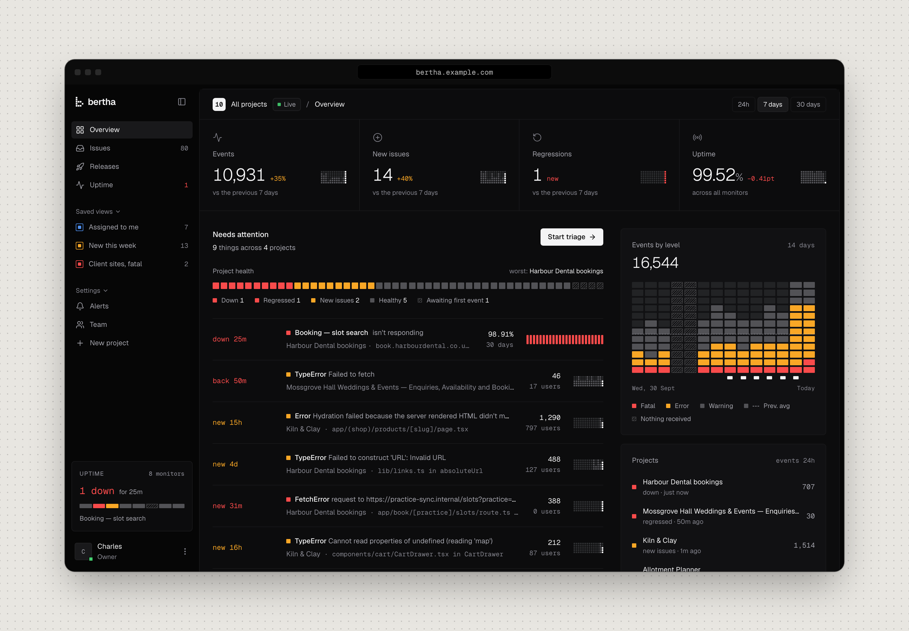
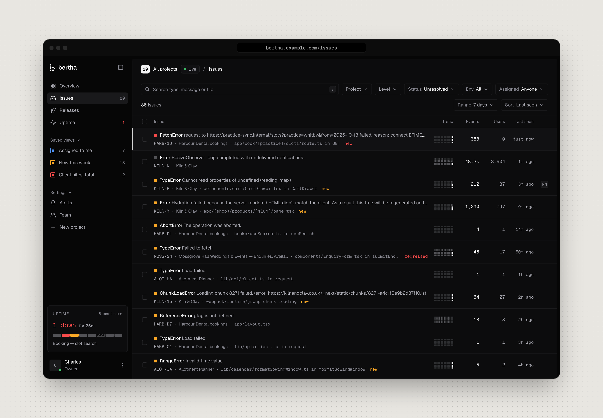
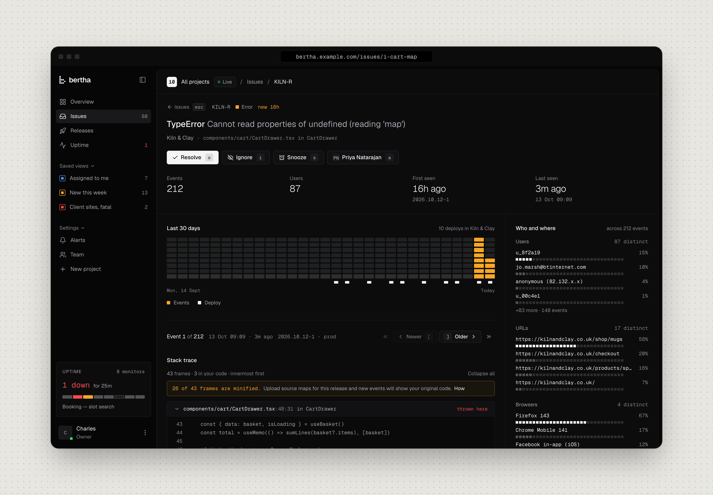
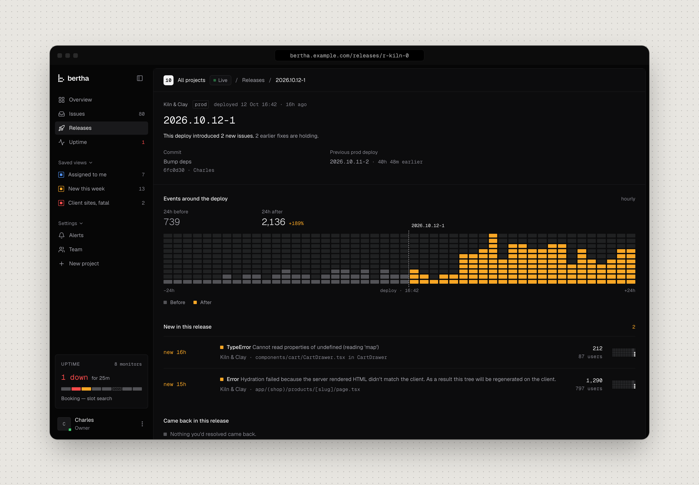
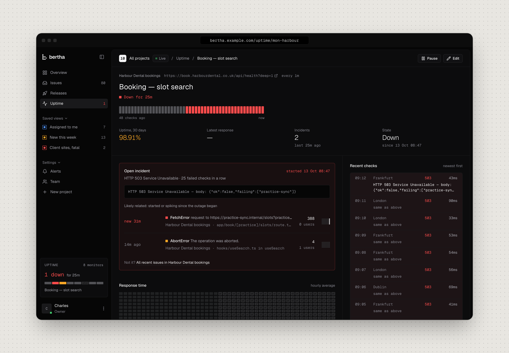

# bertha

Self-hosted error tracking and uptime monitoring for one developer's handful of small
apps. One Rust binary with the app embedded, one SQLite file, and a small SDK of its own.
It idles at about 15 MB of memory.



- **Errors:** collects them from browsers, Node, edge runtimes and Next.js, and groups
  them into issues by exception type and in-app frames. Stacks are mapped through source
  maps matched by debug id, so a minified frame shows the line that threw.
- **Triage:** resolve, snooze (for a while or for N more events), ignore, assign and add
  notes, one at a time or in bulk. A resolved issue that comes back is marked regressed.
- **Releases:** deploys are recorded from CI with their commit. Each release shows what's
  new, what regressed and what went quiet.
- **Uptime:** HTTP checks every 1, 5 or 15 minutes. Two failures in a row open an
  incident, and the monitor page shows the issues that appeared while it was down.
- **Alerts:** by email or webhook (with Slack and Discord payloads) on new issues,
  regressions, spikes and downtime, with retries and a cooldown so one storm sends one
  alert.
- **Live:** new events, regressions and monitor changes arrive without a reload.
- **People:** sign-in by emailed link. Invite collaborators to the projects they need,
  and they see nothing else.

| | |
| --- | --- |
|  |  |
| **Issues** across every project, filtered and sorted, triaged in bulk. | **An issue** with its mapped stack, the deploys around it, and who it hits. |
|  |  |
| **A release** and what changed after it went out. | **A monitor** that's down, with the issues that started with the outage. |

The screenshots show the sample data (`npm run local -- --demo`).

## Try it

```bash
npm install
npm run local                          # builds, then bertha at http://localhost:3000
npm run local -- throw "<project>"     # in another terminal: sample errors for a project
npm run local -- --demo                # or: a populated demo, clock stopped on 13 Oct 2026
```

The sign-in link prints in the terminal. More in [Running it locally](#running-it-locally).

## Run it on a server

Static Linux binaries for x86_64 and arm64 are attached to each
[release](https://github.com/felixowens/bertha/releases). `deploy/install.sh` installs or
upgrades one under systemd, behind Caddy, and rolls back if the new one won't start. See
[deploy/README.md](deploy/README.md) for the whole setup, including SMTP and Litestream
backups.

## Send it errors

Create a project in bertha; its setup page shows the snippet for its runtimes with the
keys filled in. For Next.js:

```ts
// instrumentation.ts
export { register, onRequestError } from "@bigbertha/sdk/next"
// instrumentation-client.ts
export { onRouterTransitionStart } from "@bigbertha/sdk/next/client"
// next.config.ts: stamps the release and uploads source maps after the build
import { withBertha } from "@bigbertha/sdk/next/config"
export default withBertha({})
```

The SDK is about 6.9 kB gzipped in the browser, has no dependencies and scrubs emails and
tokens by default. It's on npm as `@bigbertha/sdk`. See
[sdk/README.md](sdk/README.md) for Node, edge, the Vite plugin and the CLI.

Rust servers use `bigbertha` from crates.io: panics, errors with their causes and
backtraces, `tracing` errors, and the request on every report from axum or any tower
service. See [server/crates/bigbertha/README.md](server/crates/bigbertha/README.md).

```rust
let _bertha = bigbertha::init(bigbertha::options!());
let app = Router::new().route("/", get(home)).layer(bigbertha::tower::layer());
```

### Traces

bertha takes OpenTelemetry traces over OTLP/HTTP (`/ingest/v1/traces`, with the
project's key). An error's page then shows its request as a waterfall across services:
the error's own span, other issues' errors on the same trace, where the time went, and
calls into a service that sent nothing back. Agents read the same with `get_trace`.
Spans are kept for an hour, and a trace is kept for good once an error event names it.
The browser SDK sends the page's own requests as spans after an error; servers use
OpenTelemetry's instrumentation with the SDK's `otlp()` exporter settings (the setup page
shows the snippet).

## Triage with agents

Most triage happens in Claude Code or Codex: "please triage
https://bertha.example.com/issues/i_…". Agents reach bertha through its MCP endpoint at
`/mcp`. In bertha, open Settings → Agents, make a token for each agent or machine and run
the command it shows:

```sh
claude mcp add --transport http --scope user bertha https://bertha.example.com/mcp \
  --header "Authorization: Bearer ba_…"
```

For Codex, add this to `~/.codex/config.toml` and export the token as `BERTHA_TOKEN`:

```toml
[mcp_servers.bertha]
url = "https://bertha.example.com/mcp"
bearer_token_env_var = "BERTHA_TOKEN"
```

The tools are `get_issue`, `get_event`, `list_events`, `list_issues`, `list_projects`,
`get_release`, `get_monitor`, `add_note`, `update_issue` (which also adds and removes
labels) and `merge_issues` (for issues grouping split, like an SDK upgrade that changed
how a frame parses). `start_triage` claims an issue so two agents don't work on the same
one, and `update_triage` records what was found, tried and fixed, and how it ended; they
show in the issue's Triage section. `get_issue` includes the project's brief, the few
lines the owner writes in project settings about the stack and known noise. `report_problem` and
`request_feature` let an agent tell the owner when bertha itself got in its way; reports
show under Settings → Agents. Each one that takes an issue
accepts a link, an id or a short id like `KILN-4F`, and answers in markdown with every
frame of the mapped stack, the request with its query, breadcrumbs, the deployed commit
and notes, and says plainly what the app didn't send. The server's instructions give agents the triage steps:
read the issue, find the frames in the checkout, fix it, and record the fix with its PR.
With a GitHub token, bertha watches that PR and resolves the issue when a production
release contains it, so the agent doesn't need to come back. Without one, the fix waits
in the list ("Fix waiting to ship") until someone marks it shipped.

A token acts as the member who made it and sees only their projects. It can read, write
notes, resolve, ignore, snooze, reopen and assign, but not touch keys, team, alerts,
monitors or projects. Everything it writes shows on the issue as "Charles via claude on
laptop".

## How it's built

```
src/        the app: Vite + React + Tailwind v4; src/contract is the spec
server/     the server: axum, sqlx on SQLite, workers, the embedded app and a CLI
sdk/        @bigbertha/sdk: browser, Node, edge, Next.js, the Vite plugin and a CLI
fixtures/   sample data: npm run dev, the scenarios, seed --builtin and --demo
deploy/     systemd unit, Caddyfile, install script, Litestream
e2e/        Playwright journeys against the real binary
docs/       the design language, and the original brief and brand notes
```

The look and voice are written up in [docs/design.md](docs/design.md); see
[Credits](#credits) for the design that inspired it.

### One contract, two backends

`src/contract` is the spec. `Backend` in `actions.ts` lists every read and mutation,
and every mutation returns a `Result` with named failure kinds.

- `src/data/backend.ts` is the one seam:
  - production builds always use `src/data/http.ts`, which calls `/api/v1/…`;
  - `npm run dev` uses the fixture adapter (`src/data/fixtures.ts`) with `?scenario=`;
  - `npm run dev:api` uses the server at `BERTHA_API` (default `127.0.0.1:3000`).
- The fixtures are a dynamic import, so they never ship in a production build.
- The server's types are Rust (`server/crates/bertha-core`), generated to TypeScript with
  ts-rs into `src/api/generated` and `sdk/src/generated`. `src/api/contract-check.ts`
  asserts they equal the contract's types, so drift fails `tsc`.
- Live updates are `Backend.subscribe`. The HTTP adapter reads the server's SSE stream at
  `/api/v1/live`, filtered to the viewer's projects; the fixture adapter replays
  `fixtures/live.ts` with `&live=replay` (or drops the stream with `&live=down`).
  `src/data/live.ts` shares one subscription and turns it into the live dot, sidebar
  counts, the issue list's "N new" banner and refetches.
- Changes to the contract are logged in `CONTRACT-REQUESTS.md`.

### The server

- Ingest runs through a bounded queue and one writer. Requests never wait on the
  database, and each project is limited to 50 events a second with bursts of 500.
- Spans come in over OTLP/HTTP, protobuf or JSON, gzipped or not. They're scrubbed like
  events, kept for an hour, and kept for good once an error event names their trace.
- Issues and charts read from hourly rollups, not event scans. An hour with no data is
  shown as no data, never as zero.
- Workers in the same process check monitors, deliver alerts with retries, lift
  snoozes and delete what's past retention (`BERTHA_RETENTION_DAYS`, default 90).
- `bertha backup <path>` writes a consistent copy while it runs; Litestream covers
  continuous backup.

### Sign-in and access

- Magic links only, valid for 15 minutes and usable once. Sessions are a 30-day sliding
  cookie.
- Signing in with an unknown email says so. It's an owner tool with one or two people,
  so that's accepted over hiding who has an account.
- Mutations need `Content-Type: application/json` and `X-Bertha: 1` on top of the
  SameSite cookie.
- Collaborators see only the projects they were invited to. Every read in `bertha-db`
  takes a scope that can only come from a verified session, and `reads/tests.rs` checks
  no other project leaks.
- Owner-only actions (keys, deleting projects, team, alerts, monitors) are checked on the
  server, and the app hides them from collaborators.
- Agents use personal access tokens (`ba_…`) on `/mcp` only. bertha stores a hash, shows
  the secret once, and the session cookie doesn't work there. Revoking a token or removing
  its member stops it at the next request.
- The ingest key is the only secret an SDK holds, and it's public by design: a leaked key
  can send events up to the rate limit, and rotating it stops it at once.
- An owner can point a monitor at any URL, internal addresses included. Only the owner
  can save monitors, so that's no wider than the owner's own access.

### Limits

- Dark mode only.
- On a phone it's for a glance: lists collapse, and triage needs a laptop.
- One owner. Ownership can't be handed over yet.

## Credits

The look of bertha owes a great deal to [Halden: Fraud Analyst Dashboard](https://dribbble.com/shots/27806206-Halden-Fraud-Analyst-Dashboard)
by [Petras Nargela](https://dribbble.com/nargela) for Flair: the dark surfaces, the
square-cell charts, the mono readouts and the restrained use of colour. The framed
screenshots above borrow its presentation too.

## Development

### Running it locally

```bash
npm run local                       # builds, then bertha at http://localhost:3000
npm run local -- throw "<project>"  # in another terminal: sample errors for a project
```

This is the real binary on `.local/bertha.db`, which is kept between runs (`--fresh`
starts over). The owner is your `git config user.email` (or `--email`). Emails go to a
local SMTP sink and their links print in the terminal, starting with a sign-in link. A
test site at `127.0.0.1:4400/health` answers until you `curl -X POST
127.0.0.1:4400/down` (and `/up`), so you can watch a monitor go down and recover; checks
run every 10s. `--demo` loads the sample data instead, with the clock stopped on
13 October 2026 (owner `hello@sundial.dev`). `--no-build` skips the build.

To send real errors from an app, use the SDK snippet on the project's setup page with
`url: "http://localhost:3000"`. The examples in `sdk/examples` work too.

### The app on sample data

```bash
npm run dev -- --port 4321               # http://localhost:4321, no server needed
open http://localhost:4321/__scenarios   # every route × every state
```

`?scenario=` takes:
- a generic state for every read: `loading`, `empty` or `error`;
- a bare failure kind, such as `?scenario=conflict`;
- any named scenario in `fixtures/scenarios.ts`, such as `monitor-down`,
  `invite-expired`, `overview-collaborator` or `issues-inbox-zero`.

Add `&shell=ready` to keep the sidebar loaded, so `?scenario=loading&shell=ready` shows a
detail page's own loading state.

`node scripts/readme-screenshots.ts` retakes the README's screenshots from this server.

A few things are approximated in fixture mode only: the release page's 48-hour series,
tag breakdowns, the `allHealthy` scenario, the setup shown after `createProject`, and
`conflict`, which reports the conflict without changing the issue underneath.

### The server on its own

```bash
cd server
cargo run --features fixtures -- seed --builtin --dev-invites   # sample data, into bertha.db
BERTHA_URL=http://localhost:4321 cargo run -- serve               # then npm run dev:api in the root
```

- On an empty database, `cargo run -- owner create you@example.com --name "Your Name"`
  makes the first account. The seeded owner is `hello@sundial.dev`.
- Without `SMTP_HOST`, emails (sign-in links included) are written to the log.
- `BERTHA_FIXED_NOW=2026-10-13T10:00:00Z` stops the clock and the workers.
- The `fixtures` feature adds `seed --builtin` and `BERTHA_CHECK_EVERY_SECONDS`. Release
  builds leave it out, and refuse the variable.

### Checks

```bash
npx tsc --noEmit -p tsconfig.app.json   # the app, the contract, the fixtures and the generated types
npx tsc -p e2e/tsconfig.json            # the e2e suite
node .prototype/design-lint.ts          # token discipline

cd server
cargo fmt --all --check
cargo clippy --workspace --all-features --tests -- -D warnings
cargo test --workspace --all-features

cd sdk && npm run check && npm test && npm run size && npm run e2e

npm run build && (cd server && cargo build --release --features fixtures)
npx playwright test                     # sign-in, first event, triage, uptime, invites
```

The root `npx tsc --noEmit` uses a solution-style `tsconfig.json` with `files: []`, so on
its own it checks nothing. Use the `-p tsconfig.app.json` form.

CI (`.github/workflows/ci.yml`) runs all of it, but not on every push to main, to save
minutes. It runs on every release tag, on pull requests, weekly on main, and by hand:
`gh workflow run ci.yml` (add `--ref <branch>` for another branch). The weekly run
matters: a cache saved on a tag can only be read by that tag, so main's caches are what
each release starts from. All four jobs run side by side (under 3 minutes), and the e2e
binary uses the `e2e` cargo profile, which is release without LTO.

### Releasing

```bash
scripts/version.sh set 0.2.0      # server, Cargo.lock, SDK and its lockfile, in step,
                                  # and CHANGELOG.md's Unreleased entries move under 0.2.0
git commit -am "v0.2.0" && git push
scripts/release.sh 0.2.0          # gate, tag, push the tag
```

The tag starts `.github/workflows/release.yml`, which builds static Linux binaries for
x86_64 and arm64, plus the SDK tarball, and attaches them to a GitHub release. Then it
publishes the same tarball to npm as `@bigbertha/sdk`. A tag with a suffix
(`v0.2.0-rc.1`) is a prerelease: `install.sh` skips it, and npm gets it under the `next`
tag, so `npm install` still gets the last release.

npm publishing uses [trusted publishing](https://docs.npmjs.com/trusted-publishers): the
package's settings on npmjs.com trust `felixowens/bertha` and `release.yml`, so there's
no npm token anywhere, and each version carries provenance linking it to the run that
built it. If
the npm step fails after the GitHub release is out, fix the cause and run
`gh run rerun <id> --failed`; it skips a version npm already has.

The same run publishes `bigbertha` to crates.io, also by trusted publishing (the crate's
settings on crates.io trust the same workflow), and skips a version crates.io already has.

[`CHANGELOG.md`](CHANGELOG.md) says what each release changed, for the people running
bertha and using the SDKs. Each change they'd notice gets a line under `## Unreleased`,
in the commit that makes it, in its group: Upgrading (anything to do), bertha, Agents,
JavaScript SDK, Rust SDK, Running bertha. `version.sh set` moves those entries under the
new version and stops if there are none, and the version's section becomes its GitHub
release's notes, ending with a link to every commit since the last release. The version
beside the wordmark links to them. `node scripts/changelog.ts check` checks the file's
shape, and `node --test "scripts/*.test.ts"` tests the script.

One gate, `scripts/release-gate.sh`, guards every way a tag can go out:
- the tag matches every version, and its commit is on `origin/main`;
- `CHANGELOG.md` at that commit has entries for the version;
- locally (`release.sh` and the `pre-push` hook in `.githooks/`, which `npm install`
  turns on), a CI run on that commit, if there is one, must have passed;
- in the release workflow, the gate runs first. Then the whole CI suite and the builds
  run side by side on the tagged commit, and the release is published only if both
  pass (about 6 minutes in all). The binary must report the tag's version.

If CI fails on the tag, nothing is published. Fix it on main, then
`scripts/release.sh 0.2.0 --retry` moves the tag to the fix. A published release never
moves: fix forward with the next version. GitHub enforces both rules:
- **Immutable releases** are on, so once a release is published no one, admins included,
  can move its tag or change its files.
- **The "Release tags" ruleset** stops anyone deleting or moving a `v*` tag. Repository
  admins can bypass it, which is what lets `--retry` move a tag that was never published.
